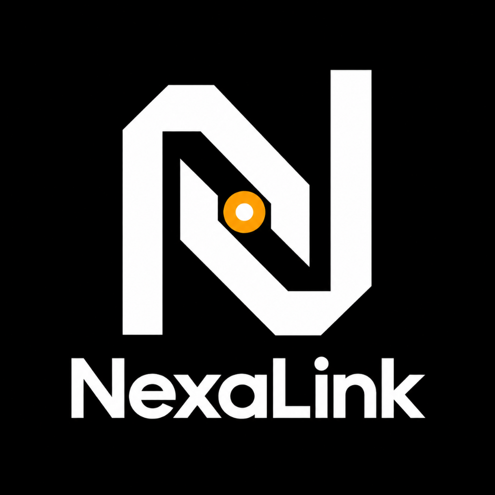
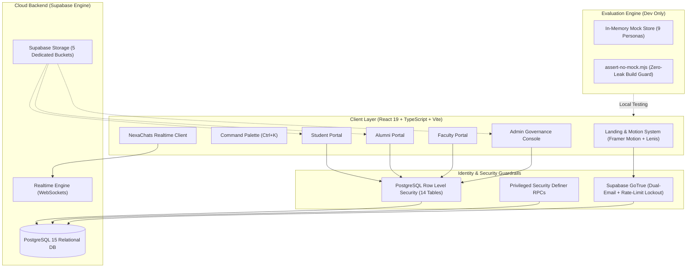

<p align="center">
  
</p>

<h1 align="center">NexaLink</h1>

<p align="center">
  <strong>Next-Generation Centralized Alumni Data Management & Engagement Platform</strong><br>
  <em>Engineered for Vidyalankar Institute of Technology (VIT), Mumbai</em><br>
  <strong>Smart India Hackathon Problem Statement SIH25017</strong>
</p>

<p align="center">
  <a href="#innovations"></a>
  <a href="#tech-stack"></a>
  <a href="#tech-stack"></a>
  <a href="#tech-stack"></a>
  <a href="#tech-stack"></a>
  <a href="#tech-stack"></a>
</p>

<p align="center">
  <a href="#overview">Overview</a> •
  <a href="#portals">Role Portals</a> •
  <a href="#innovations">Core Innovations</a> •
  <a href="#architecture">System Architecture</a> •
  <a href="#tech-stack">Tech Stack</a> •
  <a href="#dual-mode">Dual-Mode Setup</a> •
  <a href="#getting-started">Getting Started</a> •
  <a href="#security">Security & NAAC</a>
</p>

---

<a id="overview"></a>
## 📌 Platform Overview

**NexaLink** is an enterprise-grade institutional web platform designed specifically for higher education institutions to overcome the systemic challenge of fragmented alumni relationships. Built for **Vidyalankar Institute of Technology (VIT), Mumbai** under **SIH Problem Statement SIH25017**, NexaLink establishes a secure, long-term digital bridge connecting students, alumni, faculty, and administrative leadership.

### The Problem It Solves

```
Traditional Alumni Fragmentation           NexaLink Unified Ecosystem
┌───────────────────────────────┐          ┌─────────────────────────────────────────┐
│ • Inactive college emails     │          │ • Dual-Email Lifecycle (Personal Auth)  │
│ • Unverified LinkedIn claims  │  ═════>  │ • Institutional Verification & Proofs   │
│ • Fragmented messaging apps   │          │ • Privacy-Governed NexaChats            │
│ • Manual NAAC/NIRF reporting  │          │ • 1-Click Accreditation Exports         │
└───────────────────────────────┘          └─────────────────────────────────────────┘
```

- **Permanent Identity Lifecycle:** Alumni lose access to institutional `.edu` accounts post-graduation; NexaLink facilitates seamless migration to personal emails backed by institutional verification proof documents.
- **Role-Governed Interactions:** High-trust engagement model where alumni offer mentorship and corporate job referrals without spam, shielded by sovereign student consent protocols.
- **Accreditation Automation:** Generates audit-ready reports directly aligned with **NAAC Criteria 5.4.1** (Alumni Engagement & Contribution) and **NIRF** metrics.
- **Zero-Demo Leakage Dual Mode:** Ships with both a fully configured **Supabase backend** and a self-contained **Offline Evaluation Mode** with 9 deterministic personas for immediate review.

---

<a id="portals"></a>
## 👥 Role-Governed Portals

NexaLink implements four purpose-built workspaces with granular Row Level Security (RLS) enforcement:

| Role | Primary Capabilities | Institutional Governance |
| :--- | :--- | :--- |
| **🎓 Student** | • Smart heuristic mentor matching<br>• 1-click mentorship session booking<br>• Corporate job & internship applications<br>• Campus event registration & PDF ticketing<br>• Resume management & career goal tracker | • Sovereign outreach privacy toggle<br>• 10-tier responsive layout with touch parity<br>• Realtime NexaChats direct messaging |
| **💼 Alumni** | • Mentorship availability & capacity quotas<br>• Mentee request approvals & feedback logging<br>• Verified job referral postings<br>• Career milestone updates & portfolio links<br>• Sovereign student discovery & outreach | • Dual-email authentication (personal inbox)<br>• Verified badge backed by proof document<br>• Rate-limited outreach invites (5/week) |
| **🏫 Faculty / HOD** | • Departmental student & alumni rosters<br>• Mentorship program oversight & monitoring<br>• Research collaboration & academic events<br>• Departmental career outcome analytics | • Auto-approved event & job publishing<br>• Cross-department discovery privileges<br>• Seamless upgrade path to Administrator |
| **🛡️ Administrator** | • Multi-document verification queue<br>• Proof clarification workflows<br>• Bulk provisional graduation with safeguards<br>• Reported message moderation desk<br>• Live audit trails & role handoff system | • Real-time computed analytics engine<br>• NAAC Criteria 5.4.1 & NIRF export suite<br>• Audience-targeted announcements |

---

<a id="innovations"></a>
## ⚡ Core Architecture & Innovations

### 1. 💬 NexaChats — High-Privacy Realtime Messaging
- **WebSocket Subscriptions:** Live peer-to-peer messaging powered by Supabase `postgres_changes`.
- **Zero-Knowledge Admin Boundaries:** Strict RLS rules prevent administrators from inspecting private peer-to-peer chats unless explicitly flagged through the moderation workflow.
- **Rich Media & Controls:** Presigned asset attachments with Supabase Storage, inline message status receipts, and instant report-to-moderator actions.

### 2. 🎯 Sovereign Student Outreach (v2.8)
- **Consent-First Discovery:** Alumni and faculty can only discover students who explicitly toggle `open_to_outreach = true`.
- **Database-Level Masking:** Privacy redaction occurs strictly within PostgreSQL `SECURITY DEFINER` RPC functions—never on the frontend.
- **Spam Prevention Guardrails:**
  - Strict rolling quota: Maximum 5 invitations per sender per 7-day window.
  - Required justification note (20–200 characters).
  - 14-day automatic expiration on pending invitations.
  - Mandatory 60-day cooldown if a student declines an invitation.

### 3. 🛡️ Verification & Accreditation Engine
- **Confidence-Score Queue:** Automated heuristic match scoring comparing user-submitted student IDs, degree certificates, and admit cards with institutional alumni rosters.
- **Clarification Loop:** Administrators can request specific document re-uploads with contextual notes; users receive instant notifications and submission gateways.
- **NAAC / NIRF One-Click Compliance:** Exports structured Excel spreadsheets and formatted PDF dossiers tracking alumni engagement, financial contributions, and career trajectories.

### 4. 🎬 Kinetic Motion System & Responsive Parity
- **Cinematic Brand Assembly:** One-time SVG mark assembly with the central amber nexus ignition and FLIP navbar transition.
- **WebGL Particle Graph:** Custom `AlumniNetworkCanvas` simulating institutional network density with pointer and touch repulsion physics.
- **10-Tier Responsive Grid:** Conforms to 44px touch-target standards, iOS viewport safe-area insets, and dynamic font scaling to prevent mobile Safari zoom.
- **`useMotionProfile` Governor:** Auto-detects device tier, input type, and battery/refresh rates, enforcing hardware-accelerated FPS and DPR limits.

---

<a id="architecture"></a>
## 📐 System Architecture



---

<a id="tech-stack"></a>
## 🛠️ Technology Stack

| Layer | Technologies | Key Capabilities |
| :--- | :--- | :--- |
| **Frontend Framework** | **React 19**, **TypeScript 6**, **Vite 8** | Modern concurrent rendering, strict typing, sub-second HMR |
| **Styling & UI** | **Tailwind CSS v4**, **Lucide React** | Next-generation CSS engine, zero-runtime tokens, high-density iconography |
| **Kinetic Motion** | **Framer Motion 13**, **Lenis Scroll** | Physics-based springs, scrollytelling pinning, hardware-accelerated scroll |
| **Database & Auth** | **Supabase**, **PostgreSQL 15**, **GoTrue** | 14 relational tables, automated triggers, schema constraints, JWT auth |
| **Realtime Engine** | **Supabase Realtime Channels** | WebSocket message transport, live presence, instant notification broadcasts |
| **Storage Infrastructure**| **Supabase Storage** | 5 access-controlled buckets: `avatars`, `resumes`, `proof-documents`, `chat-attachments`, `event-certificates` |
| **Data Export Suite** | **jsPDF**, **jspdf-autotable**, **XLSX**, **PapaParse** | NAAC 5.4.1 compliance spreadsheets, vector event certificates, CSV reports |
| **Verification & Quality**| **oxlint**, **Puppeteer** | Static linting, automated desktop-parity test harness, responsive audits |

---

<a id="dual-mode"></a>
## 🧪 Dual-Mode Execution

NexaLink is engineered with an isolated dual-mode architecture that allows instant evaluation without cloud setup, while maintaining strict separation from production code:

<details open>
<summary><b>Mode 1 — Offline Evaluation Mode (Default & Judge-Ready)</b></summary>
<br>

- **Instant Boot:** Zero configuration required. When no Supabase keys are provided, NexaLink loads with 9 realistic seeded personas.
- **Fast Role Switcher:** Switch instantly between Student, Alumni, HOD, and Dean personas using the dev chip in the bottom right.
- **Guaranteed Isolation:** Dev mutations exist purely in volatile browser memory.
- **Zero Mock Leakage Guard:** The `postbuild` hook executes `node scripts/assert-no-mock.mjs` ensuring no test fixtures or demo secrets ever leak into production builds.

| Persona | Role | Department | Demo Focus & Highlights |
| :--- | :--- | :--- | :--- |
| **Aanya Patel** | Student | CMPN (Sem 7) | Heuristic mentor matching, active applications, 16 chats |
| **Rushabh Sanghavi** | Alumni | Google (Class of 2018) | Mentorship intake, candidate reviews, verified job postings |
| **Dr. Ravindra Sangale**| Faculty | CMPN (Head of Dept) | Departmental rosters, research mentorship, seminar hosting |
| **Dr. Sunita Rawat** | Admin | Dean of Alumni Relations | Verification desk, moderation queue, NAAC/NIRF audit exports |
| **Vikram Malhotra** | Alumni | Microsoft (Munich) | Global alumni chapter representation, international mentoring |

</details>

<details>
<summary><b>Mode 2 — Production Cloud Mode (Supabase)</b></summary>
<br>

Connect to a live Supabase instance with full Row Level Security, email verification, and live WebSockets by supplying environment variables:

```env
VITE_SUPABASE_URL=https://your-project.supabase.co
VITE_SUPABASE_ANON_KEY=your-anon-key
```

Execute migrations in sequence via the Supabase SQL Editor or CLI:
```bash
supabase/migrations/
├── 20260916000001_initial_schema.sql             # 14 core relational tables
├── 20260916000002_rls_policies.sql               # Granular Row Level Security rules
├── 20260916000003_storage_buckets.sql            # Storage policies & buckets
├── 20260916000004_seed_data.sql                  # Institutional baseline seeds
├── 20261001000001_backend_hardening.sql          # RPCs & security hardening
├── 20261009000001_student_outreach.sql           # Sovereign outreach protocol
└── 20261012000001_fix_mentorship_status.sql      # Mentorship workflow hardening
```

</details>

---

<a id="getting-started"></a>
## 🚀 Getting Started

### Prerequisites
- **Node.js**: `v18.0.0` or higher
- **npm**: `v9.0.0` or higher
- **Git**

### Installation & Local Setup

```bash
# 1. Clone the repository
git clone https://github.com/anrix05/NexaLink.git
cd NexaLink

# 2. Install project dependencies
npm install

# 3. Launch local development server (Launches in Evaluation Mode by default)
npm run dev
```

Visit [`http://localhost:5173`](http://localhost:5173) in your browser.

### Building & Verification

```bash
# Type check TypeScript codebase
npx tsc -b

# Run linter
npm run lint

# Compile production bundle and trigger zero-leak audit guard
npm run build

# Preview production build locally
npm run preview
```

---

<a id="scripts"></a>
## 📊 Project Scripts Reference

| Command | Description |
| :--- | :--- |
| `npm run dev` | Starts Vite development server with hot-module replacement |
| `npm run build` | Compiles TypeScript, bundles assets, and runs prod bundle validation |
| `npm run postbuild` | Scans `dist/` using `assert-no-mock.mjs` to block mock data leakage |
| `npm run lint` | Runs ultra-fast `oxlint` static code analysis |
| `npm run preview` | Spins up a local static server to test production build artifacts |
| `npm run test` | Executes backend services integration test harness |
| `npm run test:desktop-parity` | Puppeteer harness verifying desktop visual layouts remain intact |
| `npm run audit:responsive` | Audits viewports across 320px–1920px for overflow and target compliance |

---

<a id="security"></a>
## 🛡️ Security & Accreditation

### Institutional Security Posture
- **Strict Row Level Security (RLS):** Every database table enforces explicit PostgreSQL RLS policies; direct cross-user reads are blocked at the engine layer.
- **Dual-Email Decoupling:** Facilitates identity preservation when institutional Google Workspace/Microsoft accounts terminate after convocation.
- **Privileged RPC Boundary:** Sensitive queries (outreach masking, verification queues, admin promotion) are encapsulated in `SECURITY DEFINER` functions with rigorous caller checks.
- **Anti-Spam & Rate Limiting:** Built-in account lockout defense triggering after 5 failed password attempts, plus rolling outreach throttles.

### Accreditation Alignment (NAAC & NIRF)
- **NAAC Criteria 5.4.1 (Alumni Engagement):** One-click generation of verified records detailing alumni mentorship hours, invited talks, syllabus feedback, and financial contributions.
- **NIRF Metric Support:** Automated aggregation of student placement pipelines, alumni employer distribution, and higher studies tracking.

---

## 🏛️ Academic Attribution & License

Developed under **Smart India Hackathon Problem Statement SIH25017** (*Digital Platform for Centralized Alumni Data Management & Engagement*).

- **Institution:** [Vidyalankar Institute of Technology (VIT)](https://vit.edu.in), Wadala, Mumbai
- **Department:** Electronics And Computer Engineering
- **Copyright:** © 2026 NexaLink. All rights reserved.

<p align="center">
  <sub>Engineered with precision for institutional excellence and lifelong alumni engagement.</sub>
</p>
